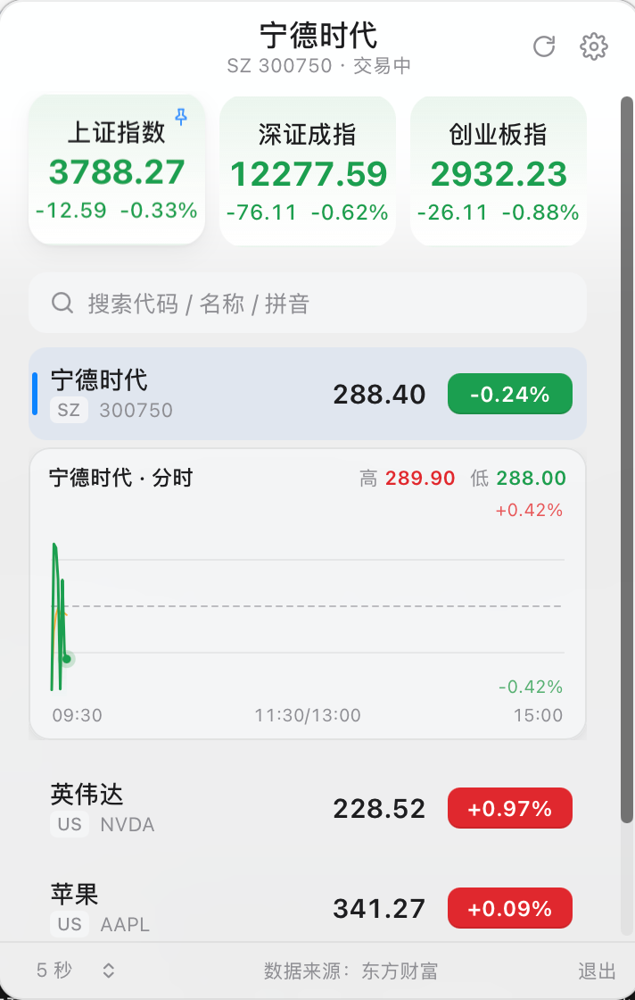
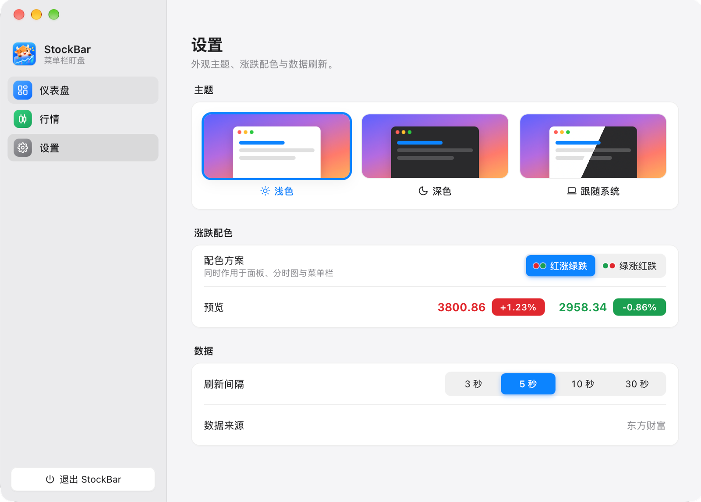

# StockBar

<p align="center">
  
</p>

**把自选行情放在菜单栏上，少切一个窗口。**

面向 macOS 的菜单栏盯盘小工具：抬眼看价格和涨跌幅，点一下看自选与分时图，不占 Dock。Windows 提供托盘与可拖动的悬浮行情条。

[](LICENSE)


[从源码运行](#快速开始) · [使用指南](docs/usage.md) · [开发与贡献](#开发与贡献)

## 为什么做它

盘中只想知道那几只自选走到哪里，不一定需要一直开着完整的行情软件。StockBar 把常看的数字留在菜单栏，需要细看时再展开小窗，看完就收起，让行情留在视线里，而不是占着工作区。

主要面向想随手看一眼行情的用户，也可作为 **Tauri 2 + 原生 TypeScript + canvas** 的小型参考实现：不用 UI 框架，不用图表库。

## 界面预览

主面板：大盘指数、搜索、自选列表与分时图。

<p align="center">
  
</p>

设置窗口：管理显示样式、标的顺序、主题与刷新间隔。

<p align="center">
  
</p>

## 日常盯盘，少一步切换

- **常看的行情直接露出来**：最多显示 3 个标的，大盘指数与自选共用名额。单行文字、双行紧凑、仅图标三种样式，名称、价格、涨跌幅按需显示。
- **需要细看时再展开**：点托盘图标查看指数、自选和分时图；支持代码、名称、拼音搜索，以及自选置顶与拖动排序。点窗口外或再点一次图标收起。
- **按桌面习惯调整**：macOS 使用菜单栏，Windows 使用悬浮行情条；支持跟随系统主题、红涨绿跌或绿涨红跌，以及 3 / 5 / 10 / 30 秒刷新间隔。

行情来自东方财富公开接口，**无需注册或 API Key**。刷新间隔可配置，但不保证交易所级实时性或接口持续可用。

## 快速开始

### 环境准备

- **Node.js 22+**，使用 pnpm（版本在 `package.json` 的 `packageManager` 字段锁定）。
- **Rust stable**，以及对应平台的 [Tauri 2 开发依赖](https://v2.tauri.app/start/prerequisites/)；Windows 需要 WebView2，Linux 需要 WebKitGTK 等系统库。
- 主要面向 macOS；Windows 有独立的托盘与悬浮行情条适配，Linux 包含兼容逻辑，表现取决于桌面环境。

### 从源码运行

```bash
git clone https://github.com/Garretqaq/stock-bar.git
cd stock-bar
pnpm install
pnpm app:dev
```

启动后点击菜单栏 / 托盘图标打开主面板，搜索并添加自选。在设置窗口的「行情」页选择要显示的标的，再到「仪表盘」调整样式与顺序。

### 打包安装

```bash
pnpm app:build
```

产物位于 `src-tauri/target/release/bundle/`。

Windows 仓库维护者还可在 [GitHub Actions](https://github.com/Garretqaq/stock-bar/actions/workflows/build-windows.yml) 手动运行 `build-windows`，从该次运行的 Artifacts 下载 MSI / NSIS 安装包。推送 `v*` 标签会构建并创建 Release 草稿；缺少 WebView2 时安装器会自动下载。

### 只预览前端

```bash
pnpm dev
```

打开 `http://localhost:1420`。无需启动 Rust，Tauri 调用自动降级为空操作；这只能预览界面，不能验证真实托盘行为。设置窗口可通过 `/settings.html` 访问，Windows 布局可通过 `/settings.html?win` 预览。

## 平台与数据边界

| 平台 | 行情展示 | 说明 |
| --- | --- | --- |
| macOS | 菜单栏文字 / 双行紧凑图片 | 不显示 Dock 图标，支持系统 template 图标适配 |
| Windows | 托盘提示 + 桌面悬浮行情条 | 行情条可拖动，托盘图标随任务栏深浅色切换 |
| Linux | 托盘 | 无 Windows 悬浮行情条；文字、图片展示受桌面环境影响 |

接口包含 A 股、港股、美股及海外指数的市场标识，数据覆盖与可用性以东方财富返回结果为准。无数据时显示 `--`。

交易状态按市场时区与最后成交时间推断，**没有节假日日历**，开盘前无法提前判断当天是否休市。完整操作、设置说明和数据规则见 [使用指南](docs/usage.md)。

## 开发与贡献

```bash
pnpm check                  # TypeScript 类型检查 + Vitest 单元测试
pnpm build                  # 类型检查 + Vite 多页面打包 → dist/
pnpm test                   # 只运行单元测试
cd src-tauri && cargo check  # Rust 侧检查
```

前端入口是 `src/main.ts`（主面板）、`src/prefs.ts`（设置窗口）和 `src/ticker.ts`（Windows 行情条）；Rust 托盘与窗口逻辑位于 `src-tauri/src/lib.rs`。详细目录与架构约定见 [AGENTS.md](AGENTS.md)。

欢迎提交 [Issue](https://github.com/Garretqaq/stock-bar/issues) 或 PR。修改纯逻辑请补充对应测试；提交前运行 `pnpm check` 和 `pnpm build`，涉及 Rust 时再运行 `cargo check`。

## 许可证

[MIT](LICENSE) · 作者：[Garretqaq](https://github.com/Garretqaq)
