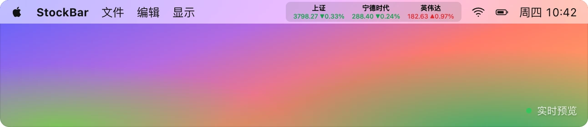
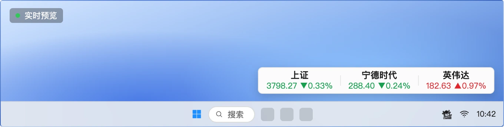
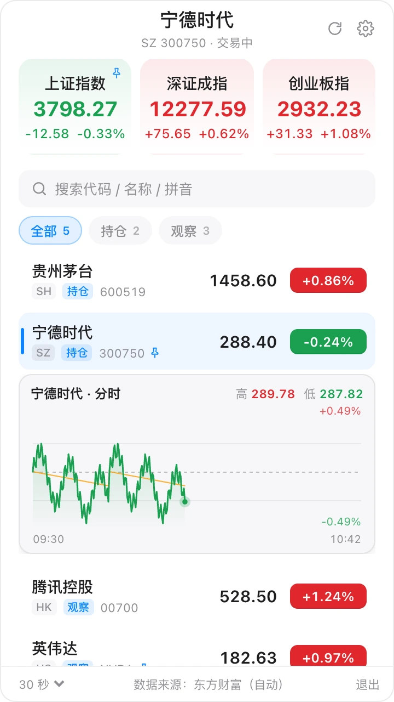
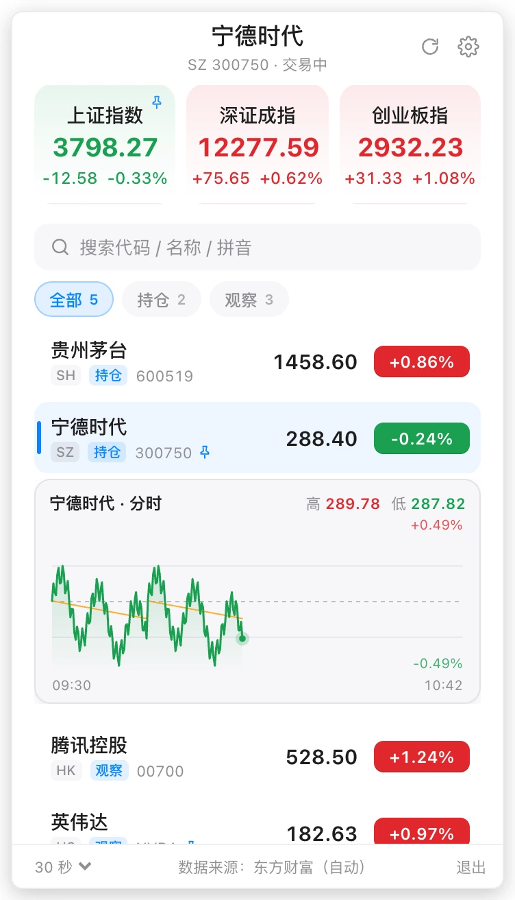
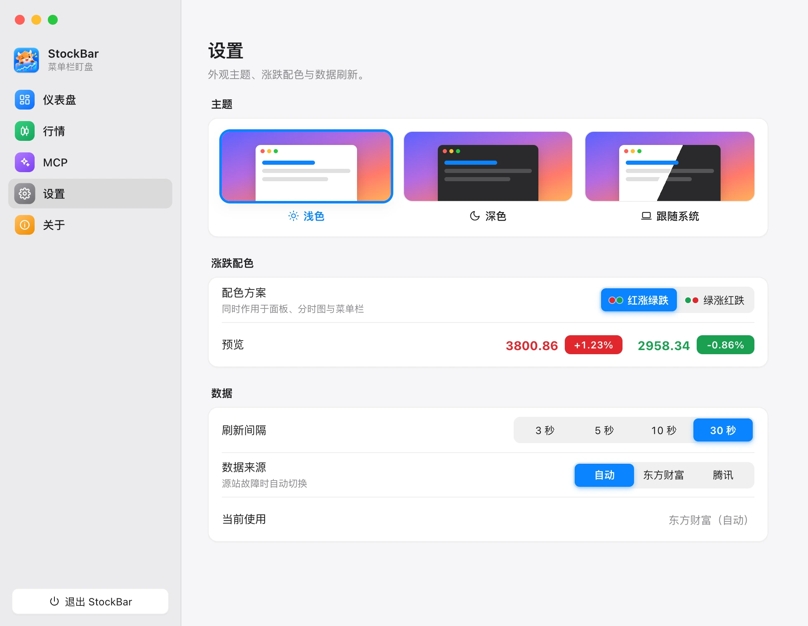
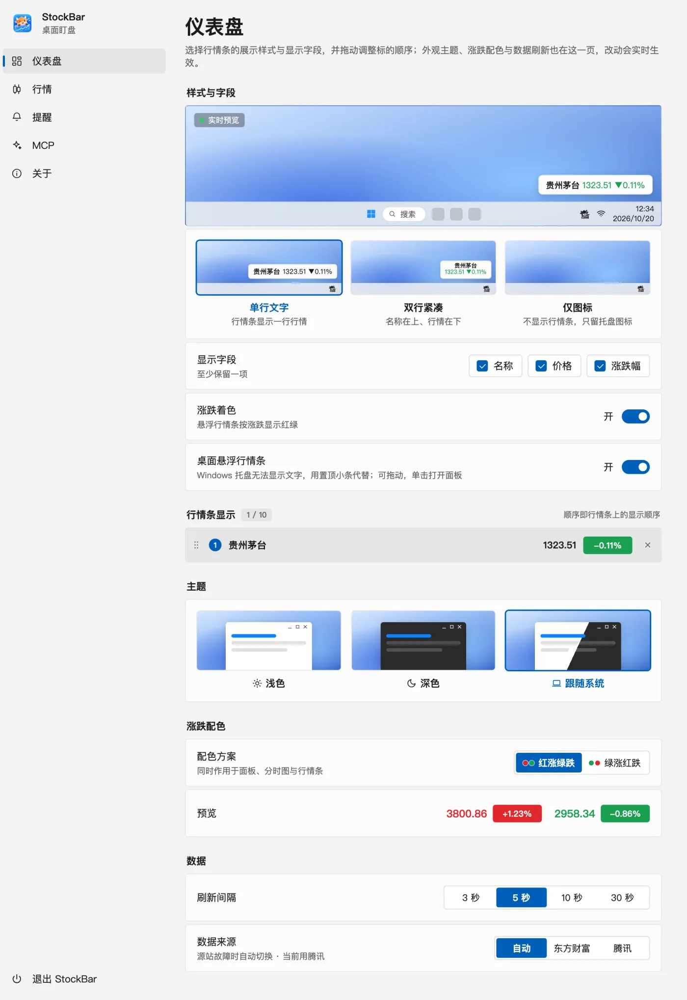

<div align="center">

# StockBar

**把行情放在菜单栏，抬眼就能看见。**

macOS 菜单栏盯盘 · Windows 悬浮行情条 · 自选分组 · MCP

[](https://github.com/Garretqaq/stock-bar/releases/latest)
[](https://github.com/Garretqaq/stock-bar/actions/workflows/build.yml)
[](LICENSE)

[**下载安装**](https://github.com/Garretqaq/stock-bar/releases/latest) · [功能一览](#功能一览) · [使用指南](docs/usage.md) · [MCP 接入](#用一句话管理自选) · [参与贡献](#开发与贡献)


</div>

盘中想看看自选，又不想一直开着完整的行情软件？StockBar 把常看的价格和涨跌幅留在菜单栏，点一下展开指数、自选与分时图，看完就收起。macOS 不占 Dock，Windows 则提供可拖动的桌面行情条，让工作区留给手头的事。

无需注册或 API Key。前端使用原生 TypeScript 与 canvas，桌面端由 Tauri 2 驱动，**不用 UI 框架，也不用图表库**。

## 下载安装

前往 [最新 Release](https://github.com/Garretqaq/stock-bar/releases/latest)，在 **Assets** 中选择对应安装包：

| 平台 | 选择的文件 | 安装方式 |
| --- | --- | --- |
| macOS · Intel / Apple Silicon | `StockBar_<版本>_universal.dmg` | 打开后将 StockBar 拖入「应用程序」 |
| Windows · x64 | `StockBar_<版本>_x64-setup.exe` | 推荐，按安装向导完成；缺少 WebView2 时会自动下载 |
| Windows · x64 | `StockBar_<版本>_x64_zh-CN.msi` | 适合偏好 MSI 的用户 |
| Linux | 暂无官方预编译包 | [从源码运行](#从源码运行)，托盘表现取决于桌面环境 |

> macOS 安装包暂未签名与公证。首次打开若被系统拦截，请右键应用选择「打开」；仍无法启动时，见下方 [常见问题](#常见问题)。

安装后，按这三步开始：

1. **添加自选**：点菜单栏 / 托盘图标，在搜索框输入代码、名称或拼音，选择结果即可添加。
2. **挑选常看的标的**：打开设置 →「行情」，将标的加入菜单栏显示；指数与自选共用 **3 个名额**。
3. **调整显示方式**：到「仪表盘」选择单行文字、双行紧凑或仅图标，勾选名称、价格与涨跌幅，并拖动调整顺序。

后续可在设置 →「关于」检查更新、一键下载安装。启动时自动检查只提示新版本，安装由你决定。

## 功能一览

| 你想做的事 | StockBar 怎么帮你 |
| --- | --- |
| 工作时顺手看行情 | macOS 菜单栏常驻；Windows 托盘提示 + 可拖动的悬浮行情条 |
| 看走势与市场成交情况 | 内置上证指数、深证成指、创业板指；点指数或自选展开分时图；指数面板显示成交额与同期对比 |
| 把自选整理清楚 | 搜索、置顶（自选行右键即可）、拖动排序、自定义分组与分组筛选；支持批量移入分组、加入菜单栏或删除 |
| 按自己的习惯显示 | 跟随系统 / 浅色 / 深色主题，红涨绿跌 / 绿涨红跌，3 / 5 / 10 / 30 秒刷新 |
| 应对数据源故障 | 报价与分时默认优先东方财富，失败时尝试腾讯；也可固定使用其中一个数据源 |
| 让 AI 帮忙整理自选 | 内置 MCP 服务，支持搜索标的、增删自选、置顶、排序与管理分组；应用界面随之同步 |

支持 A 股、港股、美股与部分海外指数，具体覆盖以数据源返回结果为准。**本 README 描述当前源码；已发布安装包的功能以对应版本的发布说明为准。**

## 双端界面预览

以下图片由当前源码实际渲染，使用示例行情数据；macOS 菜单栏与 Windows 桌面为应用内预览，Windows 界面通过项目的 `?win` 模式渲染，不包含系统原生标题栏。点击图片可查看大图。

### 行情栏：抬眼就能看见

**macOS · 菜单栏双行紧凑模式**



**Windows · 悬浮行情条与托盘**



### 主面板：展开小窗，看完即走

<table>
  <tr><th width="50%">macOS</th><th width="50%">Windows</th></tr>
  <tr>
    <td align="center"></td>
    <td align="center"></td>
  </tr>
</table>

点指数卡片或自选行即可展开分时，点击窗口外或再点一次托盘图标收起。自选较多时，用「持仓」「观察」「打新」等分组切换关注范围；分组标签支持横向滑动，放不下时可以展开查看全部分组。

**置顶、分组、菜单栏显示各管一件事**：置顶决定自选列表顺序（自选行右键即可），分组决定筛选范围，菜单栏显示决定那 3 个常驻标的。删除分组只会让成员回到「未分组」，不会删除自选。

### 设置面板：按桌面习惯调整

macOS 使用自绘窗口控件，Windows 使用对应的平台布局。主题、涨跌配色、刷新间隔与数据来源集中在「设置」页；行情栏样式与显示字段在「仪表盘」调整。

<table>
  <tr><th width="50%">macOS</th><th width="50%">Windows</th></tr>
  <tr>
    <td></td>
    <td></td>
  </tr>
</table>

[macOS 设置大图](docs/screenshots/macos-settings.webp) · [Windows 设置大图](docs/screenshots/windows-settings.webp) · [完整使用指南](docs/usage.md)

## 用一句话管理自选

StockBar 自带零依赖的 MCP 服务，让支持 MCP 的 AI 客户端按你的话整理自选。例如：

> “新建一个「持仓」分组，把宁德时代加进去并置顶。”
>
> “把苹果和英伟达移到「观察」分组。”
>
> “看看我现在有哪些自选，各放在哪个分组。”

### 接入只需三步

1. 保持 **StockBar 正在运行**，并准备 Node.js 22+。
2. 打开设置 →「MCP」，开启 MCP 开关（**默认关闭**）。
3. 点击「复制配置」，粘贴到客户端的 MCP 配置中，按客户端要求重新加载服务。

安装包已经包含脚本，复制出的路径直接指向应用内的文件，**不需要先克隆仓库**。源码运行时，也可以按下面的格式配置：

```json
{
  "mcpServers": {
    "stockbar": {
      "command": "node",
      "args": ["/absolute/path/to/stock-bar/mcp/stockbar-mcp.mjs"]
    }
  }
}
```

将 `args` 替换为你的脚本绝对路径；优先使用应用内复制的配置。

<details>
<summary>查看全部 11 个 MCP 工具</summary>

| 用途 | 工具 |
| --- | --- |
| 查看与搜索 | `list_watchlist`、`search_instrument` |
| 增删与排序自选 | `add_to_watchlist`、`remove_from_watchlist`、`move_in_watchlist` |
| 分组归属与置顶 | `set_watchlist_group`、`set_watchlist_pin` |
| 管理分组 | `create_group`、`rename_group`、`delete_group`、`move_group` |

标的可用 secid 或关键词指代，分组可用名字或 id 指代。搜索有多个匹配时会返回候选，需要进一步指定标的；大盘指数是内置的，不能通过 MCP 增删。

</details>

命令通过本机 `127.0.0.1` 上的随机端口交给应用执行，使用与界面相同的校验和同步规则。关掉 MCP 后，本地桥释放端口并删除连接信息；退出应用时也会清理。更多配置与错误排查见 [使用指南](docs/usage.md#用-mcp-配置自选)。

## 常见问题

<details>
<summary><strong>macOS 提示应用无法打开，怎么办？</strong></summary>

当前安装包未做 macOS 签名与公证。请先把应用拖到「应用程序」，右键选择「打开」。如果仍被拦截，可执行：

```bash
xattr -dr com.apple.quarantine /Applications/StockBar.app
```

更新也需要应用所在位置可写，请勿直接在 DMG 内运行。

</details>

<details>
<summary><strong>添加了自选，为什么菜单栏没显示？</strong></summary>

自选列表与菜单栏显示是独立的。请到设置 →「行情」把标的加入菜单栏，最多显示 3 个，指数也占名额。仅图标模式不显示行情文字；Windows 还需要开启悬浮行情条。

</details>

<details>
<summary><strong>行情多久刷新？休市判断准确吗？</strong></summary>

可选 3 / 5 / 10 / 30 秒刷新。行情来自公开接口，刷新频率不代表交易所级实时性。报价与分时可自动切换数据源，搜索仍使用东方财富；不同源的覆盖与数据口径可能不同，无数据时显示 `--`。

交易状态按市场时区与最后成交时间推断，没有节假日日历，开盘前无法提前知道当天是否休市。当前源码中，全市场当日成交额按沪 + 深 + 北统计，同期对比按沪深口径统计；缺少必要数据时不生成完整总额或对比。

</details>

<details>
<summary><strong>MCP 提示找不到 StockBar 的运行信息？</strong></summary>

确认应用已启动，并在设置 →「MCP」打开开关。MCP 服务需要运行中的应用处理命令；重启应用或切换开关后会使用新端口，客户端无需修改配置，可重试连接。

</details>

## 从源码运行

准备 **Node.js 22+、pnpm、Rust stable** 与对应平台的 [Tauri 2 开发依赖](https://v2.tauri.app/start/prerequisites/)。pnpm 版本由 `package.json` 的 `packageManager` 字段固定。

```bash
git clone https://github.com/Garretqaq/stock-bar.git
cd stock-bar
pnpm install
pnpm app:dev
```

只想体验前端界面，可以运行：

```bash
pnpm dev
```

打开 `http://localhost:1420` 查看主面板，`/settings.html` 查看设置，`/settings.html?win` 预览 Windows 设置布局。浏览器中 Tauri 调用会降级为空操作，真实托盘、桌面窗口、MCP 本地桥和应用内更新需要完整应用。

本地打包、更新签名与 CI 构建见 [开发指南](docs/development.md)。

## 开发与贡献

StockBar 使用 **Tauri 2 · Rust · TypeScript · Vite · canvas**。前端用原生 DOM 渲染，设置保存在本机 localStorage，通过事件在窗口间同步；托盘、窗口、MCP 本地桥与更新由 Rust 处理。

| 你想了解的部分 | 入口 |
| --- | --- |
| 行情请求、解析与数据源切换 | [`src/api.ts`](src/api.ts) |
| 自选、分组、持久化与同步 | [`src/settings.ts`](src/settings.ts) |
| 主面板 / 设置 / Windows 行情条 | [`src/main.ts`](src/main.ts) / [`src/prefs.ts`](src/prefs.ts) / [`src/ticker.ts`](src/ticker.ts) |
| 菜单栏绘制与 MCP 命令 | [`src/bar.ts`](src/bar.ts) / [`src/mcp.ts`](src/mcp.ts) |
| 桌面端窗口、托盘与本地桥 | [`src-tauri/src/lib.rs`](src-tauri/src/lib.rs) / [`bridge.rs`](src-tauri/src/bridge.rs) |

欢迎提交 [问题与建议](https://github.com/Garretqaq/stock-bar/issues) 或 [Pull Request](https://github.com/Garretqaq/stock-bar/pulls)。报告问题时，请附上系统版本、StockBar 版本、复现步骤与截图；行情问题也请注明标的和数据源。

提交前运行：

```bash
pnpm check                  # TypeScript 类型检查 + Vitest 单元测试
pnpm build                  # 前端多页面打包
cd src-tauri && cargo check  # 涉及 Rust 时运行
```

修改纯逻辑请补充对应测试。更多开发命令见 [开发指南](docs/development.md)，目录与架构约定见 [AGENTS.md](AGENTS.md)。

## 致谢与许可证

感谢 [Tauri](https://github.com/tauri-apps/tauri)、[Vite](https://github.com/vitejs/vite)、[Vitest](https://github.com/vitest-dev/vitest) 等开源项目，以及东方财富与腾讯提供的公开行情接口。

[MIT](LICENSE) © [Garretqaq](https://github.com/Garretqaq)。如果 StockBar 对你有帮助，欢迎点一颗 Star，让更多人发现它。
